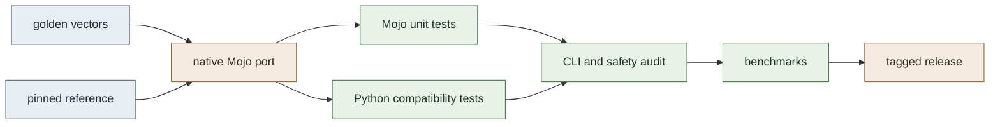

<p align="center">
  <h1 align="center">PyroMojo</h1>
  <p align="center">Native Mojo ports of widely used Python libraries — verified against the originals, benchmarked honestly.</p>
  <p align="center">
    <a href="LICENSE"></a>
    
    
    
  </p>
</p>

> **Status:** MessagePack `v0.1.0` is complete and tagged — the first finished port. Four further ports are scoped but not started.

## Project overview

PyroMojo reimplements widely used Python libraries natively in [Mojo](https://www.modular.com/mojo) and subjects each port to the same bar: byte-level verification against the pinned Python reference, a shared corpus of golden test vectors, and reproducible benchmarks that report what was actually measured.

The project exists to answer a concrete engineering question for each library:

1. Can the library's public behaviour be reproduced natively in Mojo?
2. Can that implementation be verified rigorously against the Python reference?
3. What are the measured performance characteristics, stated honestly?

The project does **not** assume that a Mojo port is faster. Performance claims are published only alongside reproducible benchmark evidence, including the cases where the reference wins.

A port is considered complete when it reproduces the documented compatibility surface, passes every verification layer, documents its deviations, and ships a benchmark report under the shared methodology.

## Library ports

| Library | Status | Version | Description |
|---|---|---|---|
| [`msgpack`](libraries/msgpack/) | Complete | `v0.1.0` | Native binary serialization codec |
| [`levenshtein`](libraries/levenshtein/) | Not started | — | Edit distance and string similarity |
| [`audioop`](libraries/audioop/) | Not started | — | Legacy audio sample manipulation |
| [`bitarray`](libraries/bitarray/) | Not started | — | Compact bit array operations |
| [`resampy`](libraries/resampy/) | Not started | — | Audio resampling |

`msgpack` is the reference project for the full workflow and the first completed implementation. The remaining entries are scoped directories only — no implementation work has begun on them.

## MessagePack spotlight

The first finished port: a complete native MessagePack v0.1 codec, [tagged `v0.1.0`](https://github.com/adarshsoloman/pyromojo/releases), covering the full type set — integers, Float32/Float64, strings, binary blobs, nil and bool, recursively nested arrays and maps, all eight extension families, and all three timestamp representations.

How it is verified:

- **Native Mojo encoder and decoder** operating on byte buffers, exposed through a length-prefixed batch CLI so Python can compare results without delegating work to the Python package.
- **Python-reference compatibility testing** against pinned `msgpack==1.2.4`, in both C-backed and pure-Python (`fallback`) modes.
- **162 golden test vectors**, generated deterministically, validated against a versioned schema, and drift-checked on every run.
- **129 Python tests and 79 native Mojo tests**, including boundary values, malformed and hostile inputs, and depth and resource limits.
- **Three-way benchmarks** (pure-Python fallback vs C-backed reference vs native Mojo) with in-process timing, warmup, and 25 measured samples per workload.

Honest results, in brief: Mojo encodes integer, map, and telemetry shapes faster than C (up to ~4x on small maps) but loses bulk byte copies (binary encode 7.4x slower than C); decode is mixed, with C ahead on scalar-dense payloads. Neither implementation is universally faster. Full tables, methodology, and limitations: [benchmark release `msgpack-v0.1`](docs/benchmarks/releases/msgpack-v0.1.md).

Details: [library README](libraries/msgpack/README.md) · [phase results](libraries/msgpack/PHASE7_RESULTS.md) · [batch protocol](libraries/msgpack/docs/batch_protocol.md)

## Engineering methodology

Every port follows the same pipeline, so a result in one library means the same thing in the next:



- **Pinned references.** Each port records the exact upstream version it is verified against (`msgpack==1.2.4`); upstream source is never vendored.
- **Golden vectors.** Deterministic, human-inspectable, schema-validated inputs and expected outputs that both implementations must satisfy. Drift fails the suite.
- **Cross-language correctness.** Python compatibility tests compare Mojo output against the reference, including error behaviour: malformed input must fail predictably, never silently.
- **Native tests.** Mojo unit tests cover each type family, boundary values, nesting and depth limits, and invalid inputs.
- **Reproducible benchmarks.** Warmup plus repeated samples, cold compilation reported separately from warm execution, environment metadata captured, raw datasets kept out of version control and curated releases committed deliberately.
- **Documented deviations.** Intentional differences from the reference are listed with rationale — for msgpack: wire-negative extension codes, a 128 vs 1024 nesting-depth limit, and textual rather than structured errors.

## Repository structure

```text
pyromojo/
├── libraries/
│   ├── msgpack/              # v0.1.0 — complete port
│   │   ├── mojo/             # native codec, batch CLI
│   │   ├── python_reference/ # vector generator, pins
│   │   ├── tests/            # mojo unit, python_compat, vectors
│   │   ├── benchmarks/       # bench executable, workloads, driver
│   │   ├── docs/             # batch protocol
│   │   └── PHASE*_RESULTS.md # per-phase reports
│   ├── levenshtein/          # not started (scope stub)
│   ├── audioop/              # not started (scope stub)
│   ├── bitarray/             # not started (scope stub)
│   └── resampy/              # not started (scope stub)
├── shared/
│   ├── benchmark_utils/      # timing harness, statistics, env capture
│   ├── reporting/            # test and benchmark report rendering
│   ├── test_vectors/
│   │   ├── schema/           # versioned vector JSON schema
│   │   └── generators/       # deterministic generation tools
│   └── validation/           # output and vector-integrity validators
├── scripts/
│   ├── run_all_tests.py      # lint, vectors, pytest, all native suites
│   ├── check_compatibility.py# build CLI, run compatibility suite
│   ├── run_all_benchmarks.py
│   └── generate_reports.py
├── benchmarks/
│   └── configs/              # shared benchmark configuration
├── docs/
│   ├── architecture.md
│   ├── roadmap.md
│   └── benchmarks/
│       ├── README.md         # binding benchmark methodology
│       └── releases/         # curated release reports
└── CONTRIBUTING.md, LICENSE, THIRD_PARTY_NOTICES.md, pyproject.toml
```

Libraries are isolated: a library may depend on `shared/` but never on another library. See [docs/architecture.md](docs/architecture.md) for the full rules.

## Getting started

Prerequisites: [uv](https://docs.astral.sh/uv/) and Python 3.11 or newer. All commands run from the repository root.

```bash
uv sync --extra dev
.venv/bin/pytest -q
```

Run the full verification pipeline (lint, vector drift check, pytest, every native Mojo suite):

```bash
.venv/bin/python scripts/run_all_tests.py
```

Check Python compatibility for the finished port:

```bash
.venv/bin/python scripts/check_compatibility.py
```

Run the MessagePack benchmark suite:

```bash
.venv/bin/python libraries/msgpack/benchmarks/run_benchmarks.py
```

## Roadmap

| Phase | Goal | Status |
|---|---|---|
| 1. Repository foundation | Maintainable project skeleton | Complete |
| 2. MessagePack v0.1 | First complete port, exercising the entire workflow | Complete (`v0.1.0`) |
| 3. First five verified ports | Prove the process generalises (`levenshtein`, `audioop`, `bitarray`, `resampy`) | Planned |
| 4. Expand toward 20 libraries | Broad, sustainable coverage | Planned |
| 5. Performance analysis | Cross-library analysis and upstream contributions | Planned |

Details, exit criteria, and deliberately omitted dates: [docs/roadmap.md](docs/roadmap.md).

## Contributing

Development workflow, quality expectations, and review requirements live in [CONTRIBUTING.md](CONTRIBUTING.md). In short:

- Open or claim an issue first; for a new port, state the target library, the pinned reference version, and the intended compatibility surface.
- Work inside a single library directory; `shared/` changes require a second real consumer.
- Keep `main` green — build and test locally before review, and submit focused pull requests.
- Match the installed Mojo toolchain's syntax, pass `ruff` (100-character lines), prefer small explicit code, and document allocation-sensitive behaviour and any deliberate deviation.
- A change is not complete until Mojo unit tests, Python compatibility tests, and golden vectors cover the new behaviour.

Do not commit generated reports, benchmark scratch data, build artifacts, or pinned environment directories.

## License

Apache License 2.0. See [LICENSE](LICENSE) and [THIRD_PARTY_NOTICES.md](THIRD_PARTY_NOTICES.md) for the third-party dependency policy.
