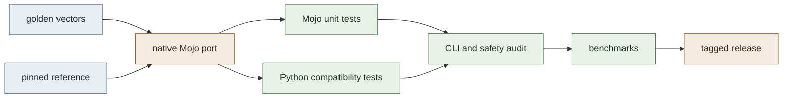

# PyroMojo

<p align="center">
  <h1 align="center">PyroMojo</h1>
  <p align="center">Native Mojo ports of widely used Python libraries — verified against the originals, benchmarked honestly.</p>
  <p align="center">
    <a href="LICENSE"></a>
    
    
    <a href="https://github.com/adarshsoloman/pyromojo/actions/workflows/tests.yml"></a>
  </p>
</p>

> **Status:** Two native ports are complete and tagged — **MessagePack `v0.1.0`** and **Levenshtein `v0.1.0`** (tagged `levenshtein-v0.1.0`) — and the **Bitarray** v0.1 implementation is complete through Phase 1E (untagged; release preparation is separate). CI runs lint, formatting, and the Python test suite on every push.

## Project overview

PyroMojo reimplements widely used Python libraries natively in [Mojo](https://www.modular.com/mojo) and subjects each port to the same bar: a reference audit, a pinned upstream reference, a shared corpus of golden test vectors, native and cross-language tests, and reproducible benchmarks that report what was actually measured.

The project exists to answer a concrete engineering question for each library:

1. Can the library's public behaviour be reproduced natively in Mojo?
2. Can that implementation be verified rigorously against the Python reference?
3. What are the measured performance characteristics, stated honestly?

The project does **not** assume that a Mojo port is faster. Performance claims are published only alongside reproducible benchmark evidence, including the cases where the reference wins.

A port is considered complete when it reproduces the documented compatibility surface, passes every verification layer, documents its deviations, and ships a benchmark report under the shared methodology.

## Library ports

| Library | Status | Version | Description |
|---|---|---|---|
| [MessagePack](libraries/msgpack/) | Complete | `v0.1.0` | Native Mojo binary serialization codec |
| [Levenshtein](libraries/levenshtein/) | Complete | `v0.1.0` | Native Mojo string distance and similarity algorithms |
| [Bitarray](libraries/bitarray/) | Implementation complete (Phases 1A–1E, untagged) | — | Native Mojo packed-bit arrays |
| [Audioop](libraries/audioop/) | Planned | — | Digital audio processing |
| [Resampy](libraries/resampy/) | Planned | — | Audio resampling |

MessagePack was the first finished port and remains the reference project for the full workflow. Levenshtein is the second finished port. Bitarray is the third port with its v0.1 implementation complete (release preparation is separate). Audioop and resampy remain scoped directories only — no implementation work has begun on them.

## MessagePack spotlight

The first finished port: a complete native MessagePack v0.1 codec, [tagged `v0.1.0`](https://github.com/adarshsoloman/pyromojo/releases/tag/v0.1.0), covering the full type set — integers, Float32/Float64, strings, binary blobs, nil and bool, recursively nested arrays and maps, all eight extension families, and all three timestamp representations.

How it is verified:

- **Native Mojo encoder and decoder** operating on byte buffers, exposed through a length-prefixed batch CLI so Python can compare results without delegating work to the Python package.
- **Python-reference compatibility testing** against pinned `msgpack==1.2.4`, in both C-backed and pure-Python (`fallback`) modes.
- **162 golden test vectors**, generated deterministically, validated against a versioned schema, and drift-checked on every run.
- **129 Python tests and 79 native Mojo tests**, including boundary values, malformed and hostile inputs, and depth and resource limits.
- **Three-way benchmarks** (pure-Python fallback vs C-backed reference vs native Mojo) with in-process timing, warmup, and repeated samples per workload.

Honest results, in brief: Mojo encodes integer, map, and telemetry shapes faster than C (up to ~4x on small maps) but loses bulk byte copies (binary encode 7.4x slower than C); decode is mixed, with C ahead on scalar-dense payloads. Neither implementation is universally faster. Full tables, methodology, and limitations: [benchmark release `msgpack-v0.1`](docs/benchmarks/releases/msgpack-v0.1.md).

Details: [library README](libraries/msgpack/README.md) · [phase results](libraries/msgpack/PHASE7_RESULTS.md) · [batch protocol](libraries/msgpack/docs/batch_protocol.md)

## Levenshtein spotlight

The second finished port: native Mojo string distance and similarity algorithms, [tagged `levenshtein-v0.1.0`](https://github.com/adarshsoloman/pyromojo/releases/tag/levenshtein-v0.1.0). The Python reference is [`rapidfuzz==3.14.6`](https://github.com/rapidfuzz/RapidFuzz) (MIT license); the GPL-licensed `Levenshtein` wrapper package is used only for black-box observation and never enters the code, tests, or dependencies.

Public operations (Unicode `str` only, code-point semantics, no normalization):

- `levenshtein_distance()` — unit costs via blocked Myers bit-parallel search; other positive-integer weights via two-row dynamic programming.
- `levenshtein_ratio()` — Indel normalized similarity (`1 - indel/(len1+len2)`), computed over a blocked bit-parallel LCS.
- `levenshtein_hamming()` — substitution counting over a single lockstep pass, no materialized arrays.

Internal algorithms: two-row dynamic-programming oracle (retained and tested as the independent correctness reference), blocked multiword Myers distance, common prefix/suffix trimming (exact for positive costs), blocked bit-parallel LCS for Indel similarity, and materialization-free Hamming comparison.

How it is verified:

- **434 golden test vectors**, generated deterministically from the pinned reference, drift-checked on every run; 432 exercised end-to-end through the batch CLI.
- **2470 adversarial differential fuzz cases** (affix-heavy pairs, weighted costs, cutoff boundaries, Unicode edge cases) plus **96 word-boundary bit-pattern cases** (sizes 1–256 around 64-bit word boundaries), all matching the reference bit-exactly, including float64 ratio bits.
- **40 native Mojo tests and 25 Python compatibility tests**, covering DP-vs-bit-parallel parity (450 randomized pairs each), trimming, Unicode (accents, CJK, astral emoji, combining sequences, NFC/NFD), weighted costs, cutoffs, error messages, and overflow guards.
- **Three-way benchmarks** (naive Python DP vs RapidFuzz `_py` fallback vs RapidFuzz C++ vs native Mojo) with in-process timing, warmup, and 25 measured samples per workload.

Honest results, in brief: affix trimming makes identical 2048-char inputs ~28x faster than the untrimmed baseline; the blocked bit-parallel LCS makes ratio up to ~45x faster on random content and collapses identical inputs ~1000x (16.7 ms to ~15 µs); materialization-free hamming is ~2–5x faster on every measured workload. Native Mojo remains slower than optimized C++ on the reported workloads (roughly 2–9x on distance, up to ~250x on ratio at large sizes) — these are measured gaps with identified causes, not universal claims. Full tables, methodology, and limitations: [benchmark release `levenshtein-v0.1`](docs/benchmarks/releases/levenshtein-v0.1.md).

Details: [library README](libraries/levenshtein/README.md) · [reference audit](libraries/levenshtein/docs/reference-audit.md) · [benchmark design](libraries/levenshtein/docs/benchmark-design.md)

## Bitarray spotlight

The third port: native Mojo packed-bit arrays, implementation-complete through Phase 1E (v0.1.0 release preparation is separate and untagged). The Python reference is [`bitarray==3.12.3`](https://github.com/ilanschnell/bitarray) (PSF-2.0).

Public operations (mutable bit arrays, packed `UInt8` storage, big/little-endian bit ordering):

- Construction from bit strings, int/bool iterables, and packed bytes; length and layout introspection (`len`, `nbytes`, `padbits`, `endian`).
- Indexing, assignment (including negative indices and resizing slices), iteration, `to01()`/`tolist()`.
- `append`, `extend`, `insert`, `delete`, concatenation (`+`/`+=`), and lexicographic comparison.
- Bitwise AND, OR, XOR, and NOT with in-place forms (equal endianness, equal lengths required) and length-preserving shifts.
- `count` (bit values and sub-patterns, bounds, steps), overlapping `search` with `right=`, and `find`/`index` with `-1`/`ValueError` miss behavior.
- `reverse`, `copy`, `fill` (zero-pad to a multiple, returns pad count), `rotate`, and byte conversion (`tobytes`/`frombytes`).

Deferred, as in the frozen scope: `frozenbitarray`, buffer-protocol interoperability, file operations, `pack()`/`unpack` utilities, sorting, `bitarray.util`, `bitarray.bitfields`, and prefix-code machinery.

Serialization preserves the logical bit length explicitly — it is never inferred from packed bytes:

```text
uint32_be nbits | uint8 endian_id | packed bytes
```

`endian_id` is `0x00` (big) or `0x01` (little); exactly `ceil(nbits/8)` data bytes follow with zeroed padding, and the decoder rejects anything else. A length-prefixed batch CLI (`0x01` ping, `0x02` echo, `0x10` decode, `0x11` encode) exposes the same framing as the other ports:

```bash
.venv/bin/mojo build libraries/bitarray/mojo/cli.mojo \
    -I libraries/bitarray/mojo -o build/bitarray_cli
```

How it is verified:

- **266 golden test vectors**, generated deterministically from the pinned reference and drift-checked on every run, covering lengths 0–65, zeros/ones/alternating/single-bit/sparse/dense/random patterns in both endiannesses.
- **74 native Mojo tests and 391 Python compatibility tests**, covering every operation above, error behavior, malformed frames, and randomized differentials.
- **No benchmarks yet** — no performance claims are made for this port.
- **Documented deviations**: `search()` returns a materialized `List[Int]` instead of a lazy iterator; Mojo uses its general `Error` type with reference message text; direct self-aliasing (`a &= a`) needs an explicit snapshot; there is no `del a[i]` syntax (`delete(i)` carries the semantics); the payload carries the logical length explicitly.

Details: [library README](libraries/bitarray/README.md) · [phase 1E probes](libraries/bitarray/docs/phase1e-reference-probes.md) · [API scope](libraries/bitarray/docs/api-scope.md)

## Engineering methodology

Every port follows the same pipeline, so a result in one library means the same thing in the next:

1. **Reference audit** — record the exact pinned version, its license, and the compatibility surface; document what is in and out of scope before coding.
2. **Algorithm and toolchain validation** — probe the Mojo toolchain's actual behaviour (integer semantics, Unicode handling, timing APIs) with throwaway experiments.
3. **Native implementation** — port the approved surface only; keep the public API minimal and the oracle implementation intact.
4. **Golden-vector and compatibility testing** — deterministic vectors with drift gates, native unit tests, and Python tests that compare Mojo output against the reference, including error behaviour.
5. **Benchmarking** — warmup plus repeated samples, cold compilation reported separately from warm execution, environment metadata captured, raw datasets kept out of version control.
6. **Targeted optimization** — only where benchmarks justify it, measured before and after against the same suite, with regressions treated as failures.
7. **Documentation and release** — curated release notes with tables, analysis, and limitations; a tagged release only when every gate passes.



- **Pinned references.** Each port records the exact upstream version it is verified against (`msgpack==1.2.4`, `rapidfuzz==3.14.6`, `bitarray==3.12.3`); upstream source is never vendored.
- **Golden vectors.** Deterministic, human-inspectable, schema-validated inputs and expected outputs that both implementations must satisfy. Drift fails the suite.
- **Cross-language correctness.** Python compatibility tests compare Mojo output against the reference, including error behaviour: malformed input must fail predictably, never silently.
- **Native tests.** Mojo unit tests cover each type family, boundary values, nesting and depth limits, and invalid inputs.
- **Reproducible benchmarks.** Warmup plus repeated samples, cold compilation reported separately from warm execution, environment metadata captured, raw datasets kept out of version control and curated releases committed deliberately.
- **Documented deviations.** Intentional differences from the reference are listed with rationale — for msgpack: wire-negative extension codes, a 128 vs 1024 nesting-depth limit, and textual rather than structured errors; for levenshtein: no normalization, code-point (not byte or grapheme) comparison, and rejection of non-UTF-8 and lone-surrogate input.

## Repository structure

```text
pyromojo/
├── libraries/
│   ├── msgpack/              # v0.1.0 — complete port
│   │   ├── mojo/             # native codec, batch CLI
│   │   ├── python_reference/ # vector generator, pins
│   │   ├── tests/            # mojo unit, python_compat, vectors
│   │   ├── benchmarks/       # bench executable, workloads, driver
│   │   ├── docs/             # batch protocol
│   │   └── PHASE*.md         # per-phase reports
│   ├── levenshtein/          # v0.1.0 — complete port
│   │   ├── mojo/             # native algorithms, batch CLI
│   │   ├── python_reference/ # vector generator, pins
│   │   ├── tests/            # mojo unit, python_compat, vectors
│   │   ├── benchmarks/       # bench executable, workloads, driver
│   │   ├── docs/             # reference audit, unicode, benchmark design
│   │   ├── experiments/      # toolchain probes and raw outputs
│   │   └── PHASE*.md         # per-phase reports
│   ├── audioop/              # planned (scope stub)
│   ├── bitarray/             # v0.1 implemented (Phases 1A–1E, untagged)
│   │   ├── mojo/             # native bitarray, batch CLI
│   │   ├── python_reference/ # vector generator, pins
│   │   ├── tests/            # mojo unit, python_compat, vectors
│   │   ├── docs/             # reference audits, API scope, probes
│   │   ├── experiments/      # toolchain probes and raw outputs
│   │   └── PHASE0_RESULTS.md # frozen scope and readiness report
│   └── resampy/              # planned (scope stub)
├── shared/
│   ├── benchmark_utils/      # timing harness, statistics, environment capture
│   ├── test_vectors/
│   │   ├── schema/           # versioned vector JSON schema
│   │   └── generators/       # deterministic vector generation tools
│   └── validation/           # output and vector-integrity validators
├── scripts/
│   ├── run_all_tests.py      # lint, vectors, pytest, all native suites
│   ├── check_compatibility.py# build CLI, run compatibility suite
│   ├── run_all_benchmarks.py
│   └── generate_reports.py
├── benchmarks/
│   └── configs/              # shared benchmark configuration
├── docs/
│   ├── architecture.md
│   ├── roadmap.md
│   └── benchmarks/
│       ├── README.md         # binding benchmark methodology
│       └── releases/         # curated release reports
└── CONTRIBUTING.md, LICENSE, THIRD_PARTY_NOTICES.md, pyproject.toml
```

Libraries are isolated: a library may depend on `shared/` but never on another library. See [docs/architecture.md](docs/architecture.md) for the full rules.

## Getting started

Prerequisites: [uv](https://docs.astral.sh/uv/) and Python 3.11 or newer. All commands run from the repository root.

```bash
uv sync --extra dev
.venv/bin/pytest -q
```

Run the full verification pipeline (lint, golden-vector drift check, pytest, every native Mojo suite):

```bash
.venv/bin/python scripts/run_all_tests.py
```

Check Python compatibility for a finished port:

```bash
.venv/bin/python scripts/check_compatibility.py
```

Run the MessagePack benchmark suite:

```bash
.venv/bin/python libraries/msgpack/benchmarks/run_benchmarks.py
```

Run the Levenshtein benchmark suite:

```bash
.venv/bin/python libraries/levenshtein/benchmarks/run_benchmarks.py
```

## Roadmap

| Phase | Goal | Status |
|---|---|---|
| 1. Repository foundation | Maintainable project skeleton | Complete |
| 2. MessagePack v0.1 | First complete port, exercising the entire workflow | Complete (`v0.1.0`) |
| 3. First five verified ports | Prove the process generalises beyond one library | In progress (3 of 5: msgpack, levenshtein, bitarray) |
| 4. Expand toward 20 libraries | Broad, sustainable coverage | Planned |
| 5. Performance analysis | Cross-library analysis and upstream contributions | Planned |

Port sequence: **1. MessagePack — Complete (`v0.1.0`, tagged). 2. Levenshtein — Complete (`v0.1.0`, tagged as `levenshtein-v0.1.0`). 3. Bitarray — implementation complete through Phase 1E (untagged; v0.1.0 release preparation is separate).** Audioop and resampy remain planned scope stubs; no implementation work has begun on them.

Details, exit criteria, and deliberately omitted dates: [docs/roadmap.md](docs/roadmap.md).

## Contributing

Development workflow, quality expectations, and review standards live in [CONTRIBUTING.md](CONTRIBUTING.md). In short:

- Open or claim an issue first; for a new port, state the target library, the pinned reference version, and the intended compatibility surface.
- Work inside a single library directory; `shared/` changes require a second real consumer.
- Keep `main` green — build and test locally before review, and submit focused pull requests.
- Match the installed Mojo toolchain's syntax, pass `ruff` (100-character lines), prefer small explicit code, and document allocation-sensitive behaviour and any deliberate deviation.
- A change is not complete until Mojo unit tests, Python compatibility tests, and golden vectors cover the new behaviour.

Do not commit generated reports, benchmark scratch data, build artifacts, or pinned environment directories.

## License

Apache License 2.0. See [LICENSE](LICENSE) and [THIRD_PARTY_NOTICES.md](THIRD_PARTY_NOTICES.md) for the third-party dependency policy.
